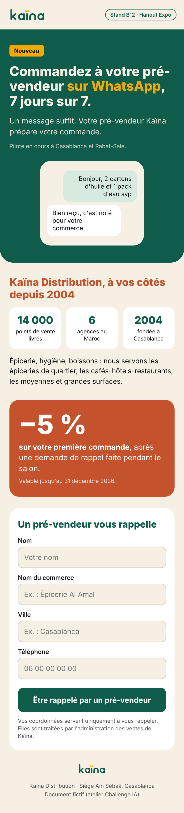

# Pitch jury — 3 minutes

*Kaïna Distribution · Yassine, Directeur régional Centre*

Rythme visé : environ 150 mots par minute. Une idée par phrase. Regarder le jury, pas l'écran.

## Script minuté

### 0:00 – 0:20 · Le problème (20 s)

> Kaïna, c'est 14 000 points de vente.
> Mais notre marge opérationnelle, c'est 3,9 %.
> 3,9 %. Ça veut dire une chose : on n'a pas droit à l'erreur.
> Pas d'erreur de chiffre. Pas d'erreur de livraison.
> Et pendant ce temps, nos épiciers testent des applications concurrentes.

*Geste : lever trois doigts sur « 3,9 % ».*

### 0:20 – 1:00 · L'erreur de l'IA que j'ai corrigée (40 s)

> On m'a remis une synthèse financière écrite par une IA. Jamais relue.
> Elle disait : Fès fait 11,97 milliards de dirhams.
> Le groupe entier fait 1,1 milliard.
> Une agence ne peut pas peser dix fois le groupe.
> J'ai cherché. Une erreur d'unité : des dirhams saisis à la place de milliers de dirhams.
> Même synthèse : « Agadir, l'agence la plus rentable, le modèle à suivre. »
> En vrai, Agadir a un EBITDA négatif six mois de suite.
> L'IA recommandait de copier notre agence en difficulté.
> J'ai fait contrôler le fichier ligne par ligne. Trois erreurs trouvées, trois corrigées.
> Ma règle depuis : l'IA propose, je vérifie la source.

*Pause d'une seconde après « dix fois le groupe ».*

### 1:00 – 2:00 · Ce que j'ai livré (60 s)

> En une journée, sept livrables.
> Un. Une nouvelle marque. Le logo « Deux points ». Un brand book.
> Et un skill qui relit chaque message avant envoi : pas de chiffre inventé, pas de promesse.
> Deux. Une présentation au comité sur la commande en ligne.
> Ma reco : tester les pré-vendeurs avec WhatsApp avant de payer une application.
> Trois. Le reporting financier, contrôlé et corrigé, avec un tableau de bord.
> Marge brute réelle : 14,2 %. Pas 16,4 % comme disait l'IA.
> Quatre. Un agent qui prépare le flash COMEX et l'envoie par e-mail.
> Cinq. Une application de flotte, en ligne, pour Driss.
> Six et sept. La landing page du salon, sur téléphone, avec un seul bouton : être rappelé. Et la vidéo du stand.
> Et là aussi, j'ai retiré cinq affirmations non vérifiées. Dont « n°1 au Maroc ».

*Compter sur les doigts. Ne pas détailler : le jury posera des questions.*

*Écran pendant « Six et sept » : montrer l'image de la landing page (5 secondes), puis passer à la démo.*

Vidéo du stand : [Kaina_Video_Stand_45s.html](Kaina_Video_Stand_45s.html) (45 s en boucle, à montrer juste après la landing page).

### 2:00 – 2:40 · La démo (40 s)

*Écran : https://kaina-six.vercel.app/Mission05_Flotte/application/ ouvert à l'avance, déjà chargé.*

> Voici Kaïna Flotte. 31 véhicules, 6 agences.
> Driss importe ses deux fichiers le lundi. Rien d'autre à faire.
> L'application calcule les alertes toute seule. Ici, 13 alertes.
> En rouge, les urgentes. Un permis expiré. Une assurance à régulariser.
> Ce bandeau : 5 véhicules ne doivent pas rouler aujourd'hui.
> Je clique sur une alerte. Je décide : valider, reporter ou escalader.
> Et on garde qui a décidé, et quand.
> Moins de camions en panne, plus de livraisons à l'heure.

*Plan B si le réseau tombe : capture d'écran de l'accueil prête dans un onglet.*

### 2:40 – 3:00 · Ma première action lundi (20 s)

> Lundi, 9 h, je suis avec Driss.
> Il importe ses fichiers. On traite ensemble les 5 alertes urgentes.
> Avant midi, chaque véhicule bloqué a un responsable et une date.
> Merci.

*Finir sur « Merci », se taire, attendre la question.*

## 3 questions pièges

**1. « Vos chiffres sortent d'une IA ? »** Réponse : non.
> Non. Ils sortent de la fiche entreprise et du fichier de reporting. L'IA m'aide à les mettre en forme. Chaque chiffre a sa source. Quand une source manque, je retire le chiffre : cinq retirés pour le salon.

**2. « Votre nouvelle marque, elle est validée ? »** Réponse : oui.
> Oui. Le logo « Deux points », la palette et le brand book sont validés. Ils sont déjà appliqués partout : présentation, tableau de bord, application, landing page, vidéo.

**3. « Votre application de flotte, elle est sécurisée ? »** Réponse : oui.
> Oui. Rien à installer, et personne ne supprime : on archive, avec qui a décidé et quand. Les données restent chez nous. La prochaine étape : des profils, pour que chacun ne voie que son agence.

## Sources des chiffres

| Chiffre | Source |
|---|---|
| 14 000 points de vente, marge opérationnelle 3,9 %, CA 1,1 milliard MAD | Fiche entreprise |
| Fès 11,97 milliards, Agadir « la plus rentable », marge 16,4 % | Synthèse IA du 3 novembre (erronée) |
| 3 erreurs (doublon Tanger, unité Fès, signe Marrakech), Agadir EBITDA négatif mai–oct. | Contrôle qualité Mission 03 |
| Marge brute 14,2 % | Tableau de bord Mission 04 (données corrigées) |
| 31 véhicules, 13 alertes, 5 véhicules immobilisés | Application Kaïna Flotte, calcul au 16/11/2026 |
| Landing page | Fiche salon : WhatsApp 7j/7 (pilote), −5 % jusqu'au 31/12/2026, champs du formulaire |
| 5 affirmations retirées | Script vidéo salon : 2 400 références, livraison 24/48 h, « 98 % satisfaits », « toujours à l'heure », « n°1 » |
